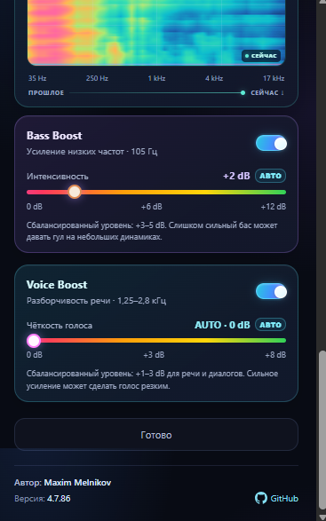

  

<h1 align="center">Volume Controller Pro</h1>

<strong>Audio control and enhancement for Microsoft Edge / Chromium</strong>

  
  
  

  <a href="#features">Features</a> ·
  <a href="#installation">Installation</a> ·
  <a href="#validation">Validation</a> ·
  <a href="Readme/Readme.md">Audit report</a>

Volume Controller Pro is a browser-audio project focused on tab volume control, audio enhancement, configurable profiles, and real-time visualizations.

> **Screenshot note:** the image above is a development reference supplied during the UI review. It may differ from the latest interface.

## Features

- **Volume control** — quick amplification presets beyond the standard 100% level.
- **Bass Boost** — adjustable low-frequency enhancement.
- **Voice Boost** — speech clarity controls with automatic and manual modes.
- **Audio profiles** — configurable behavior for supported media sites such as YouTube and Spotify.
- **Audio visualizers** — spectrum and spectrogram displays with customizable styles and palettes.
- **Customization** — themes, power-saving options, and multilingual UI.
- **Settings backup** — export and import user configuration through `.cfg` files.

## Repository status

The current `main` branch contains the project README, screenshot reference, and audit documentation. The full extension source tree has **not yet been synchronized into this repository**, so this repository alone cannot currently be loaded as an unpacked Edge extension.

## Installation

When the extension source package is available:

1. Download and extract the source package.
2. Open `edge://extensions/` in Microsoft Edge.
3. Enable **Developer mode**.
4. Select **Load unpacked**.
5. Choose the extracted directory containing `manifest.json`.

Before publishing a browser-store package, verify that `manifest.json` is located at the archive root.

## Validation

Static checks should cover:

- JavaScript syntax and JSON validity.
- Localization-key parity across English, Russian, and Ukrainian.
- HTML references, local resources, and extension manifest paths.
- ZIP integrity and package layout.

Static validation does not replace manual testing in Microsoft Edge. Verify tab audio capture, playback, volume changes, tab switching, closing captured tabs, Bass/Voice Boost, visualizers, and settings import/export.

## Documentation

- [Detailed audit report and change history](Readme/Readme.md)
- [Screenshot folder](screenshots/)

## Version

**4.7.90**

Release notes and downloadable packages should be linked from the [Releases page](../../releases) when published.

## License

No `LICENSE` file has been added yet. Until a license is chosen, this repository does not grant explicit permission to reuse or redistribute the code.
