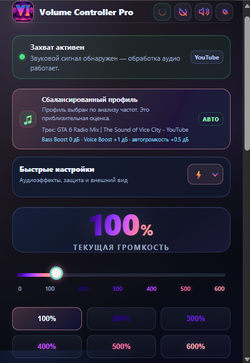
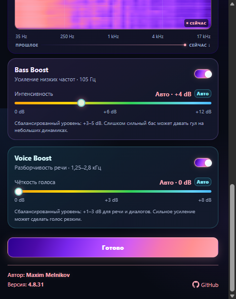
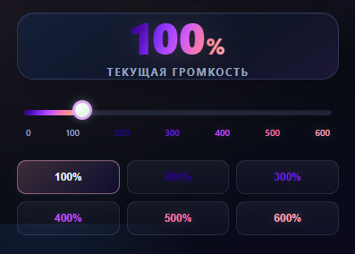
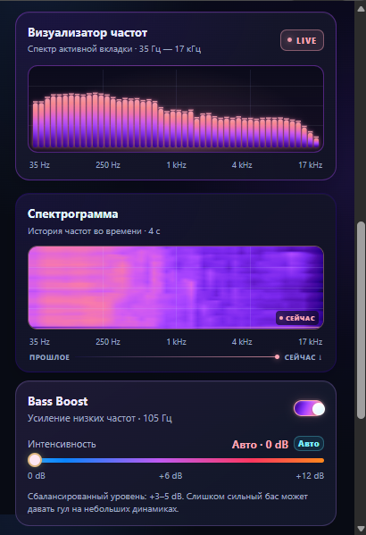

<h1 align="center">Volume Controller Pro v4.8.31</h1>

<p align="center">
  <a href="https://github.com/Maximka1993271/Volume-Controller-Pro/releases">
    
  </a>
  <a href="https://www.microsoft.com/edge">
    
  </a>
  <a href="LICENSE">
    
  </a>
  <a href="https://github.com/Maximka1993271/Volume-Controller-Pro">
    
  </a>
  <a href="https://developer.mozilla.org/en-US/docs/Web/API/Web_Audio_API">
    
  </a>
  <a href="https://github.com/Maximka1993271/Volume-Controller-Pro/issues">
    
  </a>
</p>

<p align="center">
  
</p>

<p align="center">
  <strong>🎛️ Professional audio control for Microsoft Edge / Chromium</strong><br/>
  Volume amplification, audio enhancement, and real-time visualizers for browser media.<br/>
  <strong>Free • MIT Licensed • Privacy-focused</strong>
</p>

---

## ⚠️ Official Project and Downloads

This repository is the project's official GitHub home and the only distribution channel currently maintained by the author.

- **Official repository:** [Maximka1993271/Volume-Controller-Pro](https://github.com/Maximka1993271/Volume-Controller-Pro)
- **Releases:** [Download page](https://github.com/Maximka1993271/Volume-Controller-Pro/releases)
- **Latest release (v4.8.31):** [Download `Volume.Controller.Pro.v4.8.31.zip`](https://github.com/Maximka1993271/Volume-Controller-Pro/releases/download/v4.8.31/Volume.Controller.Pro.v4.8.31.zip)
- **SHA-256 checksum:** [`Volume.Controller.Pro.v4.8.31.zip.sha256`](https://github.com/Maximka1993271/Volume-Controller-Pro/releases/download/v4.8.31/Volume.Controller.Pro.v4.8.31.zip.sha256)
- **Full release notes:** [v4.8.31](https://github.com/Maximka1993271/Volume-Controller-Pro/releases/tag/v4.8.31)
- **User guide:** [Volume Controller Pro Wiki — v4.8.31](https://github.com/Maximka1993271/Volume-Controller-Pro/tree/main/wiki)
- **Source archive:** [Download the current main source ZIP](https://github.com/Maximka1993271/Volume-Controller-Pro/archive/refs/heads/main.zip). The source tree is synchronized with the published v4.8.31 release.
- The previous [v4.7.90 release](https://github.com/Maximka1993271/Volume-Controller-Pro/releases/tag/v4.7.90) remains in the release history.
- No official Chrome Web Store or Microsoft Edge Add-ons listing is currently announced by the author.
- Be cautious with copies hosted elsewhere; use only files published through the official repository and its Releases page.

> **Repository status:** The main branch now contains the unpacked v4.8.31 source, matching manifest, locale catalogs, icons, shared modules and automated tests.

---

## ⭐ Project Highlights

- 🔊 **Volume Control** — presets from 0% to 600%.
- 🎚️ **Bass Boost** — low-frequency enhancement up to +12 dB.
- 🎤 **Voice Boost** — speech-clarity enhancement up to +8 dB, with an independent AUTO/MANUAL mode.
- 🎛️ **Audio Profiles** — separate saved settings for supported YouTube and Spotify Web Player pages.
- 🎶 **Automatic Genre Detection** — 76 title-based genre/subgenre labels and five broad audio-only profiles; see [the full catalog and EQ families](AUTO_GENRE_CATALOG.md).
- 📊 **Audio Visualizers** — seven spectrum styles (Bars, Line, Wave, Mirror, Dots, Filled area, and Radial) plus a spectrogram.
- 🎨 **GTA VI Palettes** — 25 selectable color palettes, with matching popup, spectrum, and spectrogram colors.
- ⚡ **Quick Settings** — collapsible shortcuts for frequently used audio and profile controls.
- 🛡️ **Audio Protection** — Peak Limiter, clipping warnings, and an optional limiter-off warning.
- 🌙 **Night Mode** — programme-compressor dynamics for quieter listening.
- 💾 **Settings Backup** — `.cfg` import/export with current schema version 28 and migration of supported older backups.
- 🌗 **Appearance** — Light, Dark, and System themes; optional scrollbar and panel visibility settings.
- ⚡ **Power Saving** — Balanced, Performance, and Efficiency modes for visualization workload.
- 🌐 **Localization** — English, Russian, and Ukrainian interfaces.

## 🐛 Latest Fixes — v4.8.31

- **Explicit audio acknowledgements:** volume and EQ updates now require a confirmed `{ success: true }` response from the offscreen audio processor. Missing acknowledgements are treated as failures.
- **Reliable visualizer control:** settings and enable/disable commands require confirmation during an active capture. Deferred settings remain available and are applied at the next capture start.
- **Consistent popup state:** the interface no longer shows visualizer activation optimistically when the background/offscreen pipeline has not confirmed it. This also applies after capture start, recommended settings, factory reset and backup import.
- **Serialized genre status storage:** delayed writes for an earlier track cannot overwrite a newer track's status; failed writes can be retried.
- **Accurate high-gain warnings:** popup calculations now include the active genre profile's volume trim and match the offscreen engine's effective-gain calculation.
- **Night Mode signal path:** the programme compressor remains connected for Night Mode when the separate final Peak Limiter / Safety Ceiling stage is bypassed.
- **New visualizer styles:** Added Filled area and Radial spectrum modes with EN/RU/UK labels.
- **Popup layout:** Widened the extension popup to 460 px.
- **GTA VI palette gallery:** Added 25 selectable palettes plus the classic palette. The selected theme colors popup accents, volume milestone indicators, the frequency visualizer, and the spectrogram.
- **Visualizer options:** Added the Filled area and Radial spectrum styles; added GTA VI theme support to both the spectrum visualizer and spectrogram.
- **Quick Settings:** Added a dedicated accessible expand/collapse control. The panel starts collapsed, and its state is saved independently from panel visibility.
- **Settings navigation:** Grouped settings into accessible collapsible categories and added a bottom Done button that closes the popup without changing audio state.
- **Independent Bass/Voice modes:** Bass Boost and Voice Boost retain separate AUTO/MANUAL preferences. Global genre detection changes do not force either effect back to AUTO.
- **Mode readout visibility:** Added independent visibility preferences for Bass and Voice AUTO/MANUAL dB readouts; hiding a readout does not change its effect or mode.
- **Effect and appearance preferences:** Added Hide inactive effects, scrollbar visibility, and a saved expand/collapse preference for the GTA VI palette gallery.
- **Protection controls:** Added an optional limiter-off warning and made Voice Boost's power switch available in Audio settings. High-gain warnings include active genre volume trim.
- **Backup compatibility:** Advanced settings backup schema to version 28, preserving migration paths for supported older backup versions.

**Validation:** the supplied 4.8.31 package passed 134 smoke checks. Automated tests do not replace real playback and capture tests in Microsoft Edge.

## ✅ Recommended balanced settings — v4.8.31

The one-click recommended configuration provides a moderate starting point for everyday listening:

- Master volume: 100%, unmuted.
- Bass Boost: enabled at +4 dB; Voice Boost: enabled at +2 dB; both use AUTO.
- Peak Limiter and clipping monitoring: enabled; Night Mode: disabled.
- Automatic genre detection: enabled.
- Visualizer: Bars, 48 bands, with the GTA VI theme enabled for spectrum and spectrogram.
- Power Saving: enabled in Balanced mode.
- Spectrogram history: 4 seconds.
- Quick Settings: visible and collapsed by default.
- YouTube and Spotify profiles are temporarily disabled without deleting their saved values.

The selected language, light/dark theme and GTA VI palette are preserved. This is a balanced starting point, not a universal acoustic calibration.

## 🔒 Privacy

The project is designed around local audio processing with the Web Audio API. A source-based description of permissions and local storage is available in [PRIVACY.md](PRIVACY.md). The reviewed JavaScript files contain no remote analytics endpoint or telemetry service; see the privacy notes for the limits of this static review.

For vulnerability reporting, see [SECURITY.md](SECURITY.md). Contributors should read [CONTRIBUTING.md](CONTRIBUTING.md), and maintainers should follow [RELEASE_PROCESS.md](RELEASE_PROCESS.md).

---

## ✨ Features in Detail

| Feature | Description |
|---|---|
| 🔊 **Volume 0–600%** | Boost playback beyond the standard 100% using presets. |
| 🎚️ **Bass Boost** | Low-frequency enhancement using a low-shelf filter around 105 Hz, adjustable up to +12 dB. |
| 🎤 **Voice Boost** | Speech clarity enhancement focused around the 1.25 kHz and 2.8 kHz ranges. |
| 📊 **Visualizers** | Seven spectrum styles: Bars, Line, Wave, Mirror, Dots, Filled area, and Radial; plus a configurable spectrogram. |
| 🎨 **Themes** | Light, Dark, and System options. |
| 💾 **Settings Backup** | Export/import `.cfg` settings files; current schema version 28, with migration of supported older schemas. |
| 🌙 **Night Mode** | Dynamics control intended for quieter listening. |
| ⚡ **Power Save** | Reduces visualization workload to save CPU. |
| 🎯 **Audio Protection** | Clipping warning and optional limiter-off warning, alongside the Peak Limiter. |
| 🎨 **GTA VI Palettes** | 25 selectable palettes plus the classic palette, shared with the spectrum visualizer and spectrogram. |
| ⚡ **Quick Settings** | Collapsible shortcut panel with a saved expanded/collapsed state. |
| 🌐 **Localization** | Russian, Ukrainian, and English. |

---

## 📸 Screenshots

The screenshots are arranged in a two-column gallery and show representative interface views.

<table>
  <tr>
    <td align="center" width="50%">
      <a href="screenshots/quick-settings-page.jpg">
        
      </a>
      <br/><strong>⚡ Quick Settings</strong>
    </td>
    <td align="center" width="50%">
      <a href="screenshots/voice-boost-auto-mode.jpg">
        
      </a>
      <br/><strong>🎛️ Voice Boost — Auto Mode</strong>
    </td>
  </tr>
  <tr>
    <td align="center" width="50%">
      <a href="screenshots/volume-200-clipping-warning.jpg">
        
      </a>
      <br/><strong>🚨 Volume 200% &amp; Clipping Warning</strong>
    </td>
    <td align="center" width="50%">
      <a href="screenshots/visualizer-spectrogram.jpg">
        
      </a>
      <br/><strong>📊 Visualizer &amp; Spectrogram</strong>
    </td>
  </tr>
</table>

[Open the screenshots folder](screenshots/) for full-size images.

---

## 📥 Installation

### Current repository contents

The main branch contains the unpacked extension source, including manifest.json, JavaScript, HTML, CSS, localized messages, and icons. You can install from a cloned repository or from the repository ZIP.

### Load unpacked in Microsoft Edge

1. Download and extract the complete source package.
2. Open edge://extensions/ in Microsoft Edge (or chrome://extensions/ in a compatible Chromium browser).
3. Enable **Developer mode**.
4. Select **Load unpacked**.
5. Choose the extracted project directory containing manifest.json.

Do not select the documentation-only repository directory unless it contains the extension's manifest.json.

---

## 📁 Repository Structure

```text
Volume-Controller-Pro/
├── _locales/
│   └── {en,en_GB,en_US,ru,ru_RU,uk,uk_UA}/messages.json
├── icons/
│   ├── favicon.ico
│   ├── favicon.png
│   ├── icon16.png
│   ├── icon48.png
│   └── icon128.png
├── lang/
│   ├── en.json
│   ├── ru.json
│   └── uk.json
├── .github/
│   ├── ISSUE_TEMPLATE/
│   └── workflows/
│       ├── sync-release-notes.yml
│       └── validate-extension.yml
├── Readme/
│   ├── Readme.md
│   └── RELEASE_DESCRIPTION_v4.7.90.md
├── screenshots/
├── background.js
├── content.js
├── offscreen.html
├── offscreen.js
├── popup.css
├── popup.html
├── popup.js
├── styles.css
├── manifest.json
├── shared/
│   ├── genres.js
│   └── validation.js
├── tests/
│   └── smoke.js
├── wiki/
│   ├── Home.md
│   ├── Release-Notes-v4.8.31.md
│   └── user-guide pages
├── AUTO_GENRE_CATALOG.md
├── CHANGELOG.md
├── CONTRIBUTING.md
├── LICENSE
├── PRIVACY.md
├── README.md
├── RELEASE_PROCESS.md
└── SECURITY.md
```

### Technologies

| Technology | Purpose |
|---|---|
| Manifest V3 | Browser extension platform |
| Web Audio API | Audio analysis and processing |
| Chrome Extensions API | Browser integration |
| JavaScript | Extension logic |
| HTML & CSS | Popup and settings interface |

---

## 📚 Project documentation

- [User guide and v4.8.31 Wiki](https://github.com/Maximka1993271/Volume-Controller-Pro/tree/main/wiki)
- [Full automatic genre catalog](AUTO_GENRE_CATALOG.md)
- [Changelog](CHANGELOG.md)
- [Privacy notes](PRIVACY.md)
- [Security policy](SECURITY.md)
- [Contributing](CONTRIBUTING.md)
- [Release process](RELEASE_PROCESS.md)

## 📄 License

This project is licensed under the **MIT License**. Read the full terms in [LICENSE](LICENSE).

[](LICENSE)

---

## 👤 Author

**Maxim Melnikov** — [@Maximka1993271](https://github.com/Maximka1993271)

<p align="center">
  <strong>Made with ❤️ by Maxim Melnikov</strong><br/>
  <sub>Latest release: 4.8.31 · `main` source: 4.8.31</sub>
</p>
