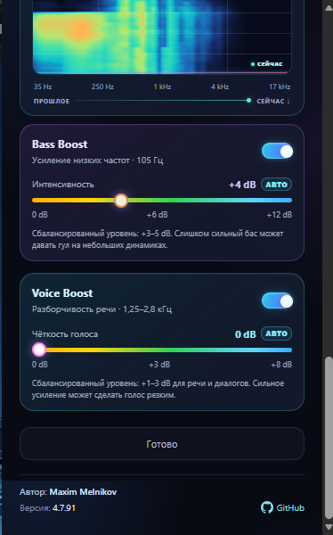
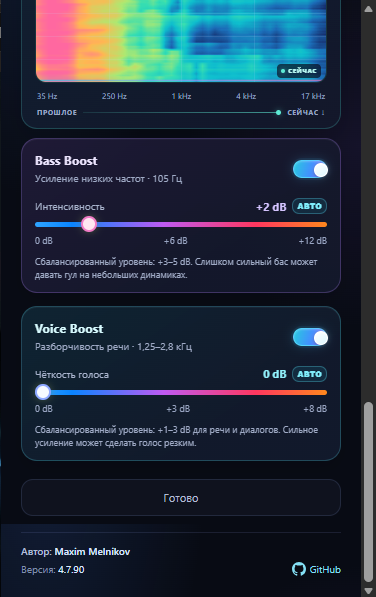
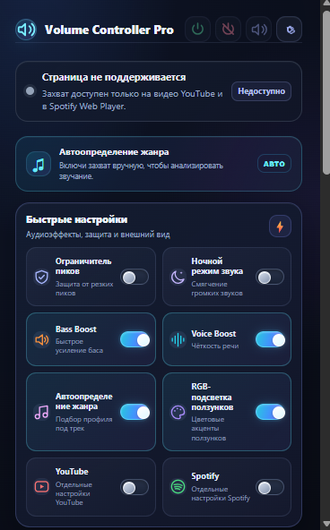
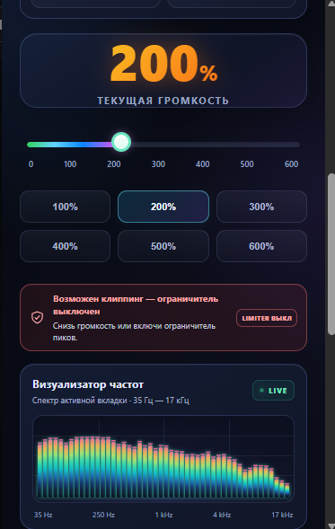
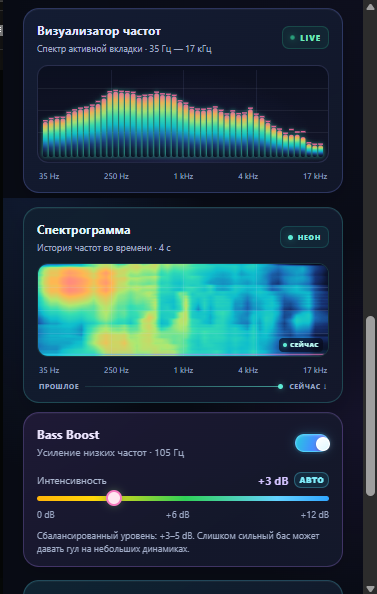

<h1 align="center">Volume Controller Pro v4.7.90</h1>

  
  
  
  
  
  

  

  <strong>🎛️ Professional audio control for Microsoft Edge / Chromium</strong> 
  Volume amplification, audio enhancement, and real-time visualizers for browser media. 
  <strong>Free • MIT Licensed • Privacy-focused</strong>

---

## ⚠️ Official Project and Downloads

This repository is the project's official GitHub home and the only distribution channel currently maintained by the author.

- **Official repository:** [Maximka1993271/Volume-Controller-Pro](https://github.com/Maximka1993271/Volume-Controller-Pro)
- **Releases:** [Download page](https://github.com/Maximka1993271/Volume-Controller-Pro/releases)
- No official Chrome Web Store or Microsoft Edge Add-ons listing is currently announced by the author.
- Be cautious with copies hosted elsewhere; use only files published through the official repository and its Releases page.

> **Repository status:** the full extension source tree has not yet been synchronized into this repository. The repository currently contains documentation, screenshots, and the license; it is not yet a complete unpacked extension source directory. Check the Releases page for an available installable package.

---

## ⭐ Project Highlights

- 🔊 **Volume Control** — presets up to 600%.
- 🎚️ **Bass Boost** — adjustable low-frequency enhancement, up to +12 dB.
- 🎤 **Voice Boost** — speech-clarity controls with AUTO and MANUAL modes.
- 🎛️ **Audio Profiles** — per-site settings for supported media sites such as YouTube and Spotify.
- 📊 **Audio Visualizers** — five spectrum styles plus a spectrogram.
- 💾 **Settings Backup** — import/export settings through .cfg files.
- 🌗 **Themes** — Dark, Light, and System options.
- 🌙 **Night Mode** — audio dynamics control for quieter listening.
- ⚡ **Power Saving** — reduces visualization workload.
- 🎯 **Clipping Detection** — visual warnings when audio peaks are detected.
- 🌐 **Three Languages** — English, Русский, Українська.

## 🐛 Latest Fixes — v4.7.90

- **Voice Boost UI:** restored the original AUTO/MANUAL pill toggle beside the level; the numerical value remains clean, for example **0 dB**.
- **Track-aware auto-tuning:** genre analysis resets when the track changes so a previous track's profile is not reused.
- **Capture race handling:** tab-close and stream-end events are serialized through the capture queue to reduce stale-event interference with new streams.
- **AudioContext lifecycle:** capture shutdown closes the audio context; a subsequent session waits for closure before creating a new context.
- **Default profile tuning:** the default profile is tuned to a moderate starting point of +4 dB Bass and +2 dB Voice.

For the detailed audit, fix rationale, and validation checklist, see [Readme/Readme.md](Readme/Readme.md). End-to-end audio capture behavior should still be tested in a real Edge installation before release.

---

## 🔒 Privacy

The project is designed around local audio processing with the Web Audio API and does not intend to include ads, tracking, telemetry, analytics, or collection of personal data.

Because the full source tree is not yet present in this repository, readers cannot independently verify the implementation from this repository alone. See the audit documentation and check the published source package when it becomes available.

---

## ✨ Features in Detail

| Feature | Description |
|---|---|
| 🔊 **Volume 0–600%** | Boost playback beyond the standard 100% using presets. |
| 🎚️ **Bass Boost** | Low-frequency enhancement using a low-shelf filter around 105 Hz, adjustable up to +12 dB. |
| 🎤 **Voice Boost** | Speech clarity enhancement focused around the 1.25 kHz and 2.8 kHz ranges. |
| 📊 **Visualizers** | Spectrum: Bars, Line, Wave, Mirror, and Dots; plus a spectrogram. |
| 🎨 **Themes** | Light, Dark, and System options. |
| 💾 **Settings Backup** | Export/import settings with a .cfg file. |
| 🌙 **Night Mode** | Dynamics control intended for quieter listening. |
| ⚡ **Power Save** | Reduces visualization workload to save CPU. |
| 🎯 **Clipping Detection** | Visual warning when audio peaks are detected. |
| 🌐 **Localization** | Russian, Ukrainian, and English. |

---

## 📸 Screenshots

  
   
  <strong>🎛️ Voice Boost — Auto Mode</strong>

  
   
  <strong>⚡ Quick Settings</strong>

  
   
  <strong>🚨 Volume 200% &amp; Clipping Warning</strong>

  
   
  <strong>📊 Visualizer &amp; Spectrogram</strong>

  
   
  <strong>✨ Clean Bass &amp; Voice Boost UI</strong>

  <a href="screenshots/voice-boost-manual-mode.jpg">Open the manual-mode screenshot at full size</a>

---

## 📥 Installation

### Current repository contents

The main branch currently contains the README, screenshot assets, the audit report, and the MIT license. The complete extension source tree is not yet present here, so these steps will work only once a source package containing manifest.json is available.

### Load unpacked in Microsoft Edge

1. Download and extract the complete source package.
2. Open edge://extensions/ in Microsoft Edge (or chrome://extensions/ in a compatible Chromium browser).
3. Enable **Developer mode**.
4. Select **Load unpacked**.
5. Choose the extracted project directory containing manifest.json.

Do not select the documentation-only repository directory unless it contains the extension's manifest.json.

---

## 📁 Repository Structure

    Volume-Controller-Pro/
    ├── Readme/
    │   └── Readme.md                   # Audit report and detailed changelog
    ├── screenshots/
    │   ├── quick-settings-page.jpg
    │   ├── visualizer-spectrogram.jpg
    │   ├── voice-boost-auto-mode.jpg
    │   ├── voice-boost-clean-ui.jpg
    │   ├── voice-boost-manual-mode.jpg
    │   └── volume-200-clipping-warning.jpg
    ├── LICENSE                         # MIT License
    └── README.md                       # Project overview

### Technologies

| Technology | Purpose |
|---|---|
| Manifest V3 | Browser extension platform |
| Web Audio API | Audio analysis and processing |
| Chrome Extensions API | Browser integration |
| JavaScript | Extension logic |
| HTML & CSS | Popup and settings interface |

---

## 📄 License

This project is licensed under the **MIT License**. Read the full terms in [LICENSE](LICENSE).

---

## 👤 Author

**Maxim Melnikov** — [@Maximka1993271](https://github.com/Maximka1993271)

  <strong>Made with ❤️ by Maxim Melnikov</strong> 
  Volume Controller Pro v4.7.90

